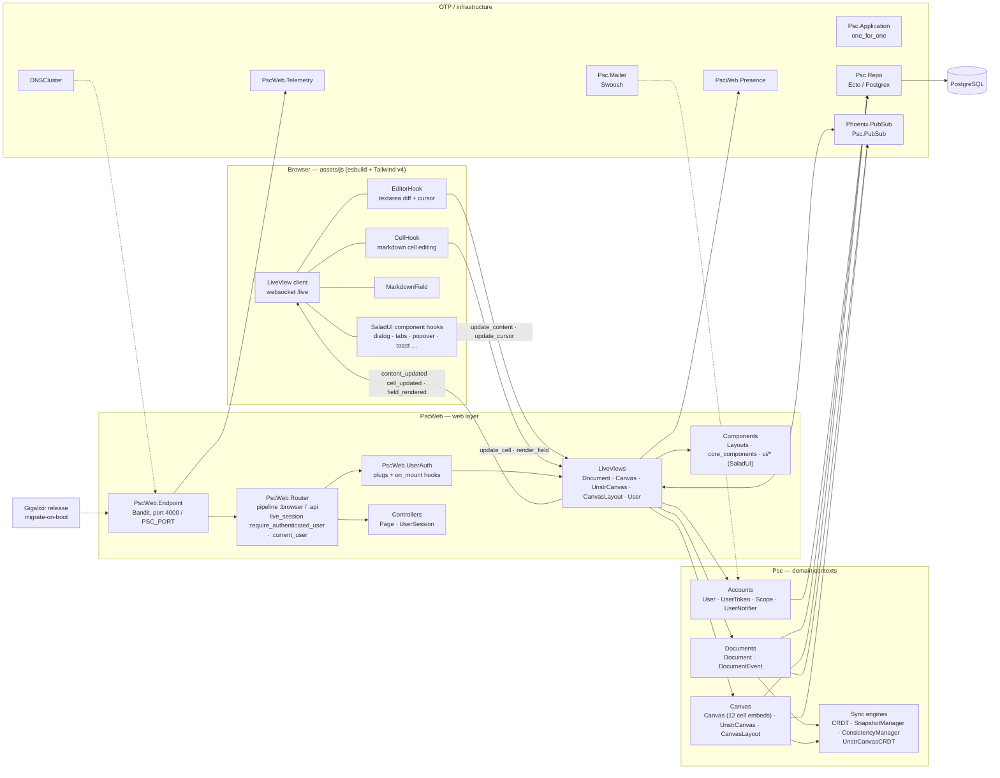

# Architecture overview

`psc-elixir` is a Phoenix 1.8 / LiveView 1.2 / PostgreSQL platform for configurable
collaborative visual-inquiry tools (Problem–Solution Canvas), with CRDT-style,
event-sourced real-time collaboration.

This diagram shows the end-to-end layering: browser hooks → `PscWeb` web layer →
`Psc` domain contexts → OTP infrastructure → Postgres.

## Related diagrams

- [design-decisions.md](design-decisions.md) — why these structures are the way they are (ADR log)
- [supervision_tree.md](supervision_tree.md) — OTP process tree under `Psc.Application`
- [documents_collaboration_flow.md](documents_collaboration_flow.md) — event-sourced text documents
- [unstr_canvas_collaboration_flow.md](unstr_canvas_collaboration_flow.md) — per-cell canvas editing
- [data_model.md](data_model.md) — Ecto schemas and tables
- [routing_map.md](routing_map.md) — routes, pipelines, and `live_session` scopes
