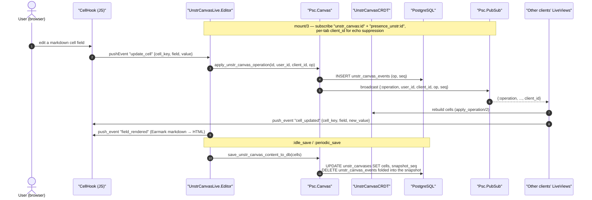

# Canvas — per-cell CRDT flow

The configurable canvas (`/canvas`) stores all cell content in a single
`cells` map. Edits are structured operations (`update_cell`, `update_name`,
`update_description`) that are event-sourced, broadcast, and folded into the map —
with a per-tab `client_id` so a client skips the echo of its own operations.

State-shape rules that must stay consistent across the editor, templates, and replay:

- Cell data lives at flat top-level keys (`cells[cell_key][field]`).
- The canvas title/description edited in the UI live under the reserved
  `"$name"` / `"$description"` keys.

## Related diagrams

- [architecture.md](architecture.md) — system-wide layering
- [documents_collaboration_flow.md](documents_collaboration_flow.md) — the text-document equivalent
- [data_model.md](data_model.md) — `unstr_canvases` / `unstr_canvas_events` tables
