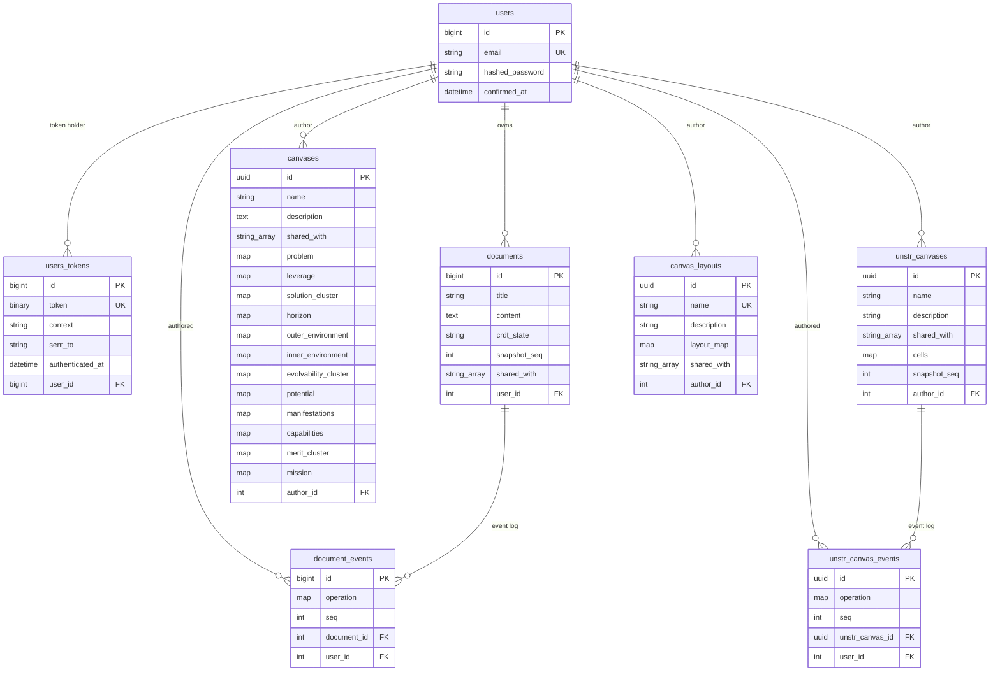

# Data model

Ecto schemas as persisted today. Sharing is by email via the `shared_with` string
array on documents, canvases, and templates; the `*_events` tables are the append-only
operation logs used to rebuild state.

**Terminology.** The domain words and the code identifiers differ:

| Domain | Table | Schema | Surface |
|---|---|---|---|
| Canvas (configurable workspace) | `unstr_canvases` | `Psc.Canvas.UnstrCanvas` | `/canvases`, `PscWeb.UnstrCanvasLive` |
| Template (reusable structure) | `canvas_layouts` | `Psc.Canvas.Layout` | `/templates`, `PscWeb.CanvasLayoutLive` |
| Problem–Solution Canvas (fixed 12 cells) | `canvases` | `Psc.Canvas.Canvas` | `/psc-canvas`, `PscWeb.CanvasLive` |

The `unstr_` prefix and the `canvas_layouts` name are historical; the vocabulary above
is what docs and the UI use.

Notes on the two canvas representations:

- `canvases` is the fixed 12-cell Problem–Solution Canvas; each cell is its own
  `embeds_one` schema (JSONB column) validated per cell.
- `unstr_canvases` is the configurable canvas: rows, columns, the 2D `layout`, and
  all cell data live inside the single `cells` map, validated against that layout.
- `canvas_layouts.layout_map` is the template definition (`rows`, `columns`,
  `layout`, `cells`) validated for grid completeness and unique field keys per
  cell.
- `snapshot_seq` on `documents`/`unstr_canvases` marks how far the saved
  `content`/`cells` has been folded; the `*_events` tables only ever hold rows
  above it, because folds delete what they covered and `Psc.EventsSweeper`
  reclaims any stale rows left behind.

## Related diagrams

- [architecture.md](architecture.md) — system-wide layering
- [documents_collaboration_flow.md](documents_collaboration_flow.md) — how the event tables are written and pruned
- [canvas_collaboration_flow.md](canvas_collaboration_flow.md) — how `cells` is updated
