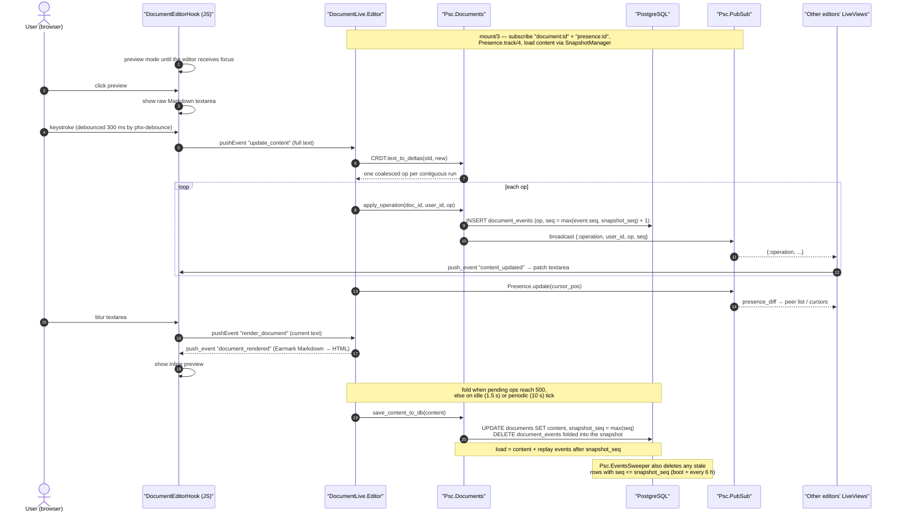

# Collaborative text documents — event-sourced CRDT flow

Each keystroke batch is diffed into delta operations, persisted as an append-only
event row, broadcast over PubSub, and folded into a content snapshot on idle/periodic
ticks. Loading replays only the events after `snapshot_seq`.

Two invariants worth remembering when changing this code:

- `next_sequence/1` is floored at `snapshot_seq`, because events at or below the
  snapshot are pruned — `max(seq)` alone would restart at 1 and place new events
  where `SnapshotManager.load_with_snapshot/1` never replays them.
- Pruning is load-bearing: free-tier Postgres is capped at 10k rows per table.
  Rows are sized so a document stays far below it — a delta op is *one row per
  contiguous edit run* (a 10k-character paste is a single row), not one row per
  character, and a fold happens at 500 pending ops at the latest.

## Related diagrams

- [architecture.md](architecture.md) — system-wide layering
- [canvas_collaboration_flow.md](canvas_collaboration_flow.md) — the per-cell equivalent
- [data_model.md](data_model.md) — `documents` / `document_events` tables
