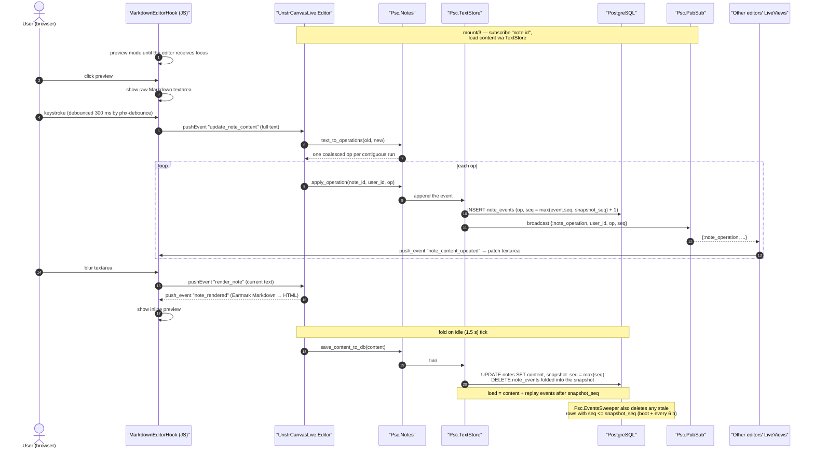

# Collaborative text — event-sourced CRDT flow

Each keystroke batch is diffed into delta operations, persisted as an append-only
event row, broadcast over PubSub, and folded into a content snapshot on idle/periodic
ticks. Loading replays only the events after `snapshot_seq`.

This is the flow for a **note** — the collaborative Markdown inside a canvas. It used
to belong to the standalone documents feature, which was retired when notes landed
(ADR-027): the algorithm now lives in `Psc.TextStore` and serves the notes, and the
canvas editor's cells have their own, cruder equivalent (see
[canvas_collaboration_flow.md](canvas_collaboration_flow.md)).

Two invariants worth remembering when changing this code:

- The next sequence number is floored at `snapshot_seq`, because events at or below
  the snapshot are pruned — `max(seq)` alone would restart at 1 and place new events
  where the loader never replays them.
- Pruning is load-bearing: free-tier Postgres is capped at 10k rows per table.
  Rows are sized so a note stays far below it — a delta op is *one row per
  contiguous edit run* (a 10k-character paste is a single row), not one row per
  character.

## Related diagrams

- [architecture.md](architecture.md) — system-wide layering
- [canvas_collaboration_flow.md](canvas_collaboration_flow.md) — the per-cell equivalent
- [data_model.md](data_model.md) — the `notes` / `note_events` tables
