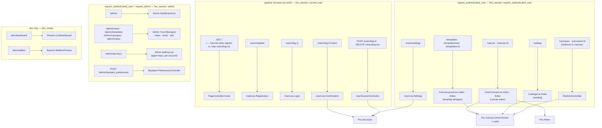

# Routing map

Which pipeline and `live_session` scope serves each route, and which context backs it.
Authentication lives entirely at the router level: `:fetch_current_scope_for_user` runs
in the `:browser` pipeline, and each `live_session` attaches the matching `on_mount`
hook.

Terminology: a **canvas** is a configurable workspace instance; a **template** is the
reusable structure it is created from.

Route additions must land inside an **existing** `live_session` block — a
`live_session` name may only be defined once in the router. Authenticated pages go in
`live_session :require_authenticated_user`; pages that work with or without a login go
in `live_session :current_user`.

The administration scope is guarded twice: the `:require_admin` plug protects the dead
render, and the `:require_admin` `on_mount` re-checks the role on the live connection.
Backpex's preference endpoint lives in that same scope, behind the same plugs.

## Related diagrams

- [architecture.md](architecture.md) — system-wide layering
- [data_model.md](data_model.md) — what each LiveView persists to
