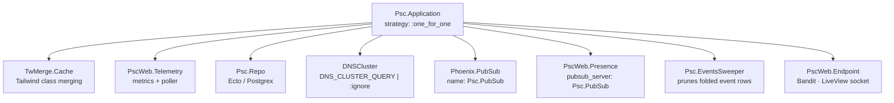

# OTP supervision tree

Children started by `Psc.Application` under a `:one_for_one` supervisor, in start order.

Name | Type | Notes |
|---|---|---|
| TwMerge.Cache | library | Tailwind class merging |
| PscWeb.Telemetry | library | metrics + poller |
| Psc.Repo | Ecto | pooled Postgres connections |
| DNSCluster | library | no-op unless `DNS_CLUSTER_QUERY` is set |
| Phoenix.PubSub | library | `Psc.PubSub` |
| PscWeb.Presence | library | per-document cursors |
| Psc.EventsSweeper | app | deletes event rows already folded into `snapshot_seq`; boot + every 6 h |
| PscWeb.Endpoint | Phoenix | Bandit, LiveView socket |

The endpoint is deliberately last so the HTTP server only accepts traffic once
Repo, PubSub, and Presence are up.

## Related diagrams

- [architecture.md](architecture.md) — system-wide layering
- [notes_collaboration_flow.md](notes_collaboration_flow.md) — how PubSub and Presence are used
